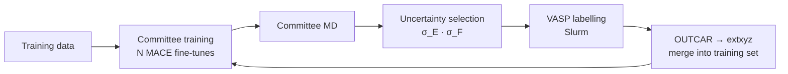

# mlip_auto_flow

**English** · [中文](README.zh-CN.md)

**Know where an interatomic potential breaks before your simulation does.**

mlip_auto_flow is a physics-based, six-level evaluation framework for machine-learning interatomic potentials (MLIPs), paired with active-learning scripts. It runs every potential through L0–L5 checks against one frozen DFT/AIMD reference, from energy and force errors up to the melt–quench pathway. It reports where the potential fails, by how much, and which structures to label next.

**[Try MLIP Workbench](https://qundaoxu.github.io/mlip_auto_flow/workbench/)** · [Project page](https://qundaoxu.github.io/mlip_auto_flow/) · [Reference](docs/reference.md)


---

## 1. Why this framework

Machine-learning potentials now run molecular dynamics at close to DFT accuracy. Universal models such as MACE-MPA-0 handle most materials zero-shot, and specialised models are trained for a single system. One question still has no standard answer: **can this potential be trusted for this material?**

- **A low force RMSE is not enough.** A potential can match DFT forces well and still get the liquid structure, diffusion or crystallisation pathway wrong.
- **Validation is scattered.** Physical checks are spread across papers, run under different protocols, and cannot be compared.
- **Data building relies on experience.** Nobody can say which structures are missing from a training set, or why.

mlip_auto_flow puts these questions under one protocol. Every potential is tested on the same reference data with the same frozen post-processing. Each failure is traced to a level, a number and the structures behind it, and those structures go straight into the next round of labelling: **evaluate → find the failure → add data → retrain.**

## 2. The evaluation framework

### Six levels, from numbers to physics

| Level | Question it answers | What is measured |
|---|---|---|
| **L0** Reference agreement | Are energies, forces and stresses right on given structures? | Errors against DFT, broken down by element, force magnitude and state |
| **L1** PES sanity | Is the potential-energy surface free of pathologies? | Pair curves, invariances, energy–force consistency, NVE drift, high-temperature stability |
| **L2** Static equilibrium | Are the crystal phases right? | Relaxed volumes, equation of state (V₀, B₀), phase order, formation energies |
| **L3** Disordered structure | Are liquid and glass right? | RDF, bond angles, coordination, rings, S(q) |
| **L4** Dynamics | Is atomic motion right? | Species-resolved diffusion |
| **L5** Process | Is the melt–quench pathway right? | Structure along the temperature programme, first divergence from AIMD |

### What you get

- **A gate that saves compute.** L1 is a go/no-go check. A potential with a broken energy surface is stopped before the expensive L4/L5 runs.
- **Grades against the reference's own noise.** A model that is no further from AIMD than independent AIMD runs are from each other gets an A. Every number is stored with its reference, protocol and structures.
- **Relative scores and rankings.** Universal and specialised potentials are compared on one scale, level by level, with adjustable weights.
- **Failure structures for the next labelling round.** The worst structures are de-duplicated and exported with a suggested DFT protocol.
- **Leakage control.** Metrics a specialised potential was trained on are flagged and can be excluded from the ranking.
- **Scoring off the cluster.** The cluster runs the model and writes an evaluation pack. L0–L2 are then scored anywhere, on a CPU, with the same code.
- **MLIP Workbench.** An interactive web application with report cards, L0–L5 plots, model comparison, trajectory inspection and sampling, plus an upload panel that analyses L0–L2 in the browser.

Five model families are supported: MACE, NequIP, DeePMD, MatterSim and CHGNet.


**Fig. 1 | Nine potentials on GST225.** Changing only the training data, from MACE-MPA-0 to MACE-spec-GST, raises L0 from 63 to 90, while L1 drops from 93 to 50: the specialised model's pair curves fail at short range, where its training data does not reach. The levels show what a single error number hides.

## 3. The sampling scripts

`al_flow/` closes the data loop: a committee of fine-tuned MACE models runs MD, and the structures they disagree on are sent to DFT.



- **One command for the whole loop** (`alflow run`), or one command per stage (`train`, `sample`, `label`, `collect`, `merge`) for a platform scheduler.
- **Uncertainty sampling** selects frames on energy and force disagreement within the committee.
- **DFT handling built in.** The scripts write VASP inputs, submit and poll the jobs, check convergence, and merge the results into the next training set.
- **Connected to the evaluation.** Uncertainty sampling only finds where the committee disagrees. The evaluation adds what it cannot see: the failing L0–L5 structures (`mlipeval candidates`) join the same labelling batch.

In the eight-generation replay on GST225, the overall score rises from 59.9 to 81.8, though not monotonically with the amount of data. No generation passes the L1 gate. That gap is invisible to uncertainty sampling, and the evaluation points straight at it.

## 4. Walkthrough: GST225

GST225 (Ge₂Sb₂Te₅), a phase-change memory material, is the first full case. It spans crystalline phases, liquid, glass and the melt–quench transition. Its reference is 208 DFT/AIMD tasks under one protocol, `gst225_pbe_canonical_v1`. Seventeen potentials have been evaluated: five universal models, four GST-specialised models and eight active-learning generations.

### Try it in the browser (one minute)

1. Open [MLIP Workbench → New evaluation](https://qundaoxu.github.io/mlip_auto_flow/workbench/#new).
2. Pick one of the nine showcase models and click **Fill in**. The GST225 DFT reference and the model's outputs load level by level.
3. Click **Analyse all**. L0–L2 are computed in your browser and match the HPC results metric for metric.
4. Click **Generate report card** to see the model's scores and rank against the other eight.

The same panel accepts your own DFT and MLIP files; the formats are listed under each level.

### Run it on your cluster

**Install and configure**

```bash
git clone https://github.com/qundaoXu/mlip_auto_flow.git && cd mlip_auto_flow
pip install -e ".[al]"
mlipeval config --init mlip_auto_flow.yaml     # set paths.workspace, environment.conda_root, scheduler.project
mlipeval config --check
```

**Evaluate a model**

```bash
mlipeval submit --model mace_mpa0 --chain      # L0 → L1 → L2 → MD → L3 → L4 → L5 as one PBS chain
mlipeval card --model mace_mpa0
```

```console
MACE-MPA-0 (medium)  —  overall 76.5  (rank 7/9, all scoring)
  L0   63.4
  L1   93.4
  L2   65.9
  L3   76.5
  L4   75.9
  L5   94.5
  L1 gate: pass
  candidates for the next labelling round: 2
```

The energy surface is sound, but energies and forces (L0) and the crystal phases (L2) lag behind. The framework has already picked the structures to fix them:

```bash
mlipeval candidates --model mace_mpa0 --out round1/eval_candidates
```

**Add data and retrain**

```bash
alflow train  --train data/sub_train.xyz --valid data/sub_val.xyz --test data/sub_test.xyz --n-comm 4
alflow sample --models committee/model*/comm_v1_model*.model --init-conf data/small_cell_traj.xyz --temp 600
cat comm_traj/uncertain_frames.xyz round1/eval_candidates/*.xyz > round1/to_label.xyz
alflow label  --frames round1/to_label.xyz --template-dir dft_input --submit --wait
alflow collect --root dft_cal
alflow merge  --base data/sub_train.xyz --new dft_cal/dft_merged.extxyz --out data/train_round1.xyz
```

**Evaluate the new model against the old one**

Register the new checkpoint under `models:` in `mlip_auto_flow.yaml`; no code changes are needed. Then run:

```bash
mlipeval submit --model mace_gst_r1 --chain
mlipeval rank --models mace_mpa0,mace_gst_r1 --markdown --out-stem r1_vs_mpa0
```

If the gate is open and the scores meet the target, release the model. Otherwise export the new failures and run another round.

## 5. Interfaces and integration

mlip_auto_flow plugs into a materials-computing platform in four ways. Choose by where your data lives.

| Interface | Use it when | How |
|---|---|---|
| **Command line** | Your platform schedules jobs on HPC | `mlipeval` (evaluation) and `alflow` (active learning). `card --json`, `models --json` and every `alflow` stage print JSON; exit codes are passed through |
| **Evaluation packs** | Models run on the cluster, scoring happens elsewhere | `mlipeval pack model --model KEY` writes a `.mlippack`; `mlipeval rescore PACK` scores L0–L2 on any CPU and checks the pack against the frozen reference |
| **Web API** | You want a service | `mlipeval serve` starts a local backend: upload a pack, verify it, rescore it, and read results as JSON or in the Workbench page |
| **Browser upload** | You want to try your own data without installing anything | The Workbench *New evaluation* panel reads extxyz/CSV/JSON per level and computes L0–L2 locally; nothing is uploaded |

**Adding a model** takes one config entry, with backend, checkpoint, conda environment and LAMMPS route. Built-in entries cover the 17 GST225 models.

**Outputs** are plain files: one JSON record per metric (`results/models/<model>/*.json`), candidate structures as extxyz with a manifest, and rankings as JSON and Markdown.

A typical evaluation-driven training job runs:

```text
alflow train → sample → label → collect → merge              inner loop, every round
mlipeval run l0 / l1 / l2  →  mlipeval card --json            quick check: continue or release
mlipeval candidates --out next_round/                         failing structures join the next label
mlipeval run md / l3 / l4 / l5                                full evaluation at milestones
```

## Learn more

- [MLIP Workbench guide](docs/workbench/README.md): the six workspaces, the upload formats, running locally
- [Reference](docs/reference.md): configuration keys, the full command-line reference, result files, repository layout
- [Evaluation packs and the web API](eval_framework/PACKS.md)
- [Metric definitions](eval_framework/METRICS.en.md) and the [L0–L5 specification](docs/validation_methods_L0-L5.en.md)
- Level-by-level notebooks: [`eval_framework/notebooks/`](eval_framework/notebooks/)
