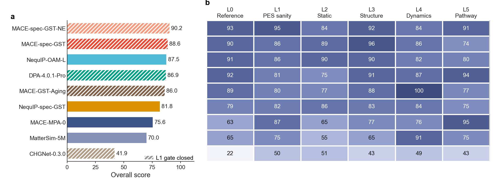
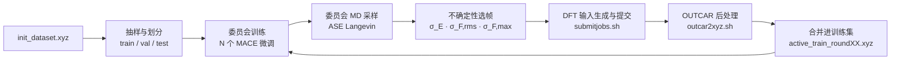

# mlip_auto_flow

**机器学习原子间势（MLIP）的分级评估框架与主动学习训练脚本。**

项目主页（排名、L0–L5 图解、AL 阶梯回放）：**https://qundaoxu.github.io/mlip_auto_flow/**

本仓库包含两部分代码：

| 部分 | 目录 | 作用 |
|---|---|---|
| 评估框架（主体） | [`eval_framework/`](eval_framework/) | L0–L5 分层诊断：从能量/力的数值一致性一直测到熔融–淬火路径，给出可回溯的指标、判级、跨模型排名，以及失败构型与补数据建议 |
| 主动训练配套脚本 | [`al_flow/`](al_flow/) | MACE 委员会训练 → MD 采样 → 不确定性选帧 → VASP 标注 → OUTCAR 后处理与数据集合并，循环迭代 |

两者通过命令行工具 `mlipeval` 和 `alflow`（[`mlipeval_cli/`](mlipeval_cli/)）衔接。这两个命令也是后续接入材料计算平台的接口。

---

## 目录

- [研究背景](#研究背景)
- [研究问题](#研究问题)
- [评估框架简介](#评估框架简介)
- [主动训练配套脚本简介](#主动训练配套脚本简介)
- [安装](#安装)
- [CLI](#cli)
- [平台集成](#平台集成)
- [仓库结构](#仓库结构)
- [已知限制](#已知限制)

---

## 研究背景

机器学习原子间势已经能以接近 DFT 的精度做大尺度分子动力学，但"一个势函数在某个材料上到底可不可靠"仍然缺少可复现、可量化的判据。本项目要建立的正是这样一套分层 benchmark。

**模型演进。** MLIP 从早期的 BP/GAP，到 SchNet 等不变性模型，再到 NequIP、MACE 等等变模型，精度持续提升。近年出现了在晶体数据库（MPTrj、Alexandria 等）上训练的通用势，例如 MACE-MPA-0，可以零样本完成大部分常规模拟。

**两个瓶颈。** 针对特定体系，获得精准、可靠的势函数仍然困难：

- **训练数据难构建。** 训练结构的组成和挑选高度依赖经验，缺少"缺什么补什么"的系统方法。
- **可靠性难评估。** 能量和力的 RMSE 低，不代表结构、扩散或相变路径就正确。物理验证指标分散在各篇文献中，协议不统一，难以横向比较。

**benchmark 的作用。** 一套分层、带不确定度的评估体系可以判定势函数质量、指导高效的数据集构建、对通用势和专用势做多维度比较，也可以为自动化势函数开发 Agent 提供评价信号。本仓库把评估框架和主动学习脚本放在一起，就是为了让"评估 → 找出失败 → 补数据 → 再训练"成为一个闭环。

**案例体系。** 选材标准是：有成熟的发表工作和开源势函数，并且模拟需求对势函数的覆盖面广。拟定四种材料：Si、In₂O₃、Ge₂Sb₂Te₅（GST225）和 LiGePS。第一阶段先以相变存储材料 GST225 跑通全流程，因为它同时涉及晶相、液态、非晶和熔融–淬火过程，对势函数的要求最全面。第一阶段的参考数据共 208 个 DFT/AIMD 任务，协议为 `gst225_pbe_canonical_v1`。

## 研究问题

核心问题是：**在同一套参考数据、同一协议和同一套冻结后处理参数下，一个 MLIP 在哪一层物理性质上开始失效，失效有多大，是否超出参考自身的统计噪声，以及应该补什么训练数据。**

由此引出三个具体问题：

1. 通用势在 GST225 上零样本使用时，各层级的误差签名是什么？
2. 用体系专用数据训练（架构与通用势对齐，只换训练数据），能修好哪些问题、修不好哪些？
3. 主动学习各代数据集的规模和组成，如何影响各层级得分？

三个问题的结果都在[项目主页](https://qundaoxu.github.io/mlip_auto_flow/)上：9 个势函数（5 个通用势 + 4 个 GST 专用势）的排名、L0–L5 逐级图解，以及 8 代 AL 数据集的回放。



**Fig. 1｜GST225 上 9 个势函数的相对得分（去污染口径）。** **a** 总分（最佳 = 100），斜线表示 L1 门控未通过。**b** 分层得分。专用势与对应的通用势架构相同，例如 MACE-MPA-0 → MACE-spec-GST 只换了训练数据，总分从 75.6 升到 88.6。

---

## 评估框架简介

### L0–L5 分层诊断

| 层级 | 检验什么 | 代表指标 | 参考 |
|---|---|---|---|
| **L0** 数值一致性 | 能量、力、应力与 DFT 的偏差，以及失效出现在什么环境 | MAE / RMSE / P99 / max，按元素、力幅、温度段分箱 | H5 审计集 120 帧（canonical 重算）+ 晶体诊断集 |
| **L1** 势能面健全性 | 不依赖 DFT 的病理检查，作为后续层级的门控 | 6 条二体 PEC、平移/旋转不变性、F = −∇E、晶格扫描、2000 K 最小间距、时间步敏感性、NVE 漂移 | 无参考 |
| **L2** 静态平衡性质 | 基态、相对能、势能面曲率 | 弛豫体积、固定体积离子弛豫 EOS 的 V₀/B₀、四级相阶梯排序与 ΔE、组成修正形成能 | 静态 DFT |
| **L3** 无序结构 | 液态与非晶的短程序（L3a）和中程序（L3b） | 偏 RDF、ADF、配位数、同极键、Ge 四面体序、环分布、ALTBC、S(q) | AIMD（每个状态点 3 条副本） |
| **L4** 动力学 | 结构正确时，原子运动是否也合理 | 分物种 MSD、自扩散系数 Δlog₁₀D（附拟合窗口） | 定温 AIMD |
| **L5** 过程与相变 | 给定温度程序下的整条路径，而不只是终态 | 熔融–淬火过程中 RDF 峰、CN、四元环、四面体 Ge 随温度的演化，首次偏离，终态误差 | AIMD 熔融–淬火 |

- **L1 是门控。** 出现 NaN、非物理短键、能量不守恒等问题时，按规则不再运行昂贵的 L4/L5（`run_all.py` 直接跳过）。
- **后处理参数先冻结。** L3 的键截断取自 AIMD 偏 RDF 的第一极小值，然后对 AIMD 和 MLIP-MD 两侧同时冻结。分箱和成环算法也一样，两侧只有引擎不同。
- 每一级的完整解析见 [`eval_framework/notebooks/`](eval_framework/notebooks/)（nb01–nb06 对应 L0–L5，nb07 是跨模型排名）。指标定义见 [`eval_framework/METRICS.md`](eval_framework/METRICS.md)，规范见 [`docs/validation_methods_L0-L5.md`](docs/validation_methods_L0-L5.md)。

### 判级规则

判级把模型与参考之间的距离，除以参考自身的不确定度。一句话：模型离 AIMD 不比 AIMD 离自己更远，就是 A。

```text
σ_eff = max(σ_ref, d_protocol / 2)
z_eff = |distance(model, ref)| / σ_eff
z_eff ≤ 1 → A    1–2 → B    2–4 → C    > 4 → F
```

σ_ref 来自独立参考轨迹之间的差异，d_protocol 来自同一批结构在两套 DFT 协议下的差异。只有一条参考轨迹时不给正式等级，结果标为 `provisional`。目前 L3–L5 有 3 条 AIMD 副本，可以正式判级；L0–L2 仍是 `provisional`。

横向比较另用一套**相对分**：逐指标按 `100 × (x_best + floor) / (x_i + floor)` 折算，再按层级权重加权（L0 0.20、L1 0.15、L2 0.15、L3 0.25、L4 0.15、L5 0.10）。floor 是该指标的物理或统计分辨尺度。相对分不受 provisional 的限制，因为同一条参考对所有模型的偏置相同。

### 数据角色与泄漏控制

- `training`：可用于训练。
- `diagnostic`：可用于定位问题和选择补数据。
- `protected_audit`：不得用于补数据、微调或超参数选择。

每个专用势都要先做训练集泄漏筛查：先比组成，再比总 RDF 指纹，阈值 0.02。受污染的指标自动降为 `provisional`，排名时对所有模型一起排除（"去污染"口径）。不同 DFT 协议（PBE、PBEsol、PBE+U、不同赝势）的标签各自独立保存，不混在一起算 RMSE。

### 代码组织

```text
eval_framework/scripts/
├── mlipeval/                  分析包
│   ├── l0_reference.py        L0      ├── l3a_short_range.py   L3a
│   ├── l1_pes.py              L1      ├── l3b_medium_range.py  L3b
│   ├── l2_static.py           L2      ├── l4_dynamics.py       L4
│   ├── l5_pathway.py          L5      ├── uncertainty.py / ensemble.py   误差尺度与三副本判级
│   ├── schema.py              MetricResult、判级        ├── ranking.py      相对分与排名
│   ├── leakage.py             泄漏筛查                  ├── failure_export.py  补算候选导出
│   ├── models.py              模型注册表                ├── calculators.py  各后端的统一封装
│   └── md_runner.py / md_lammps.py   MLIP-MD（ASE / LAMMPS）
├── run_l0.py … run_l5.py, run_mlip_md.py, run_all.py     每一级的 driver
├── run_ranking.py, run_report.py                          排名与验收报告（纯后处理）
├── submit_pbs.py, submit_al_ladder.py                     PBS 作业链
└── screen_*_leakage.py, screen_al_ladder.py               训练集泄漏筛查
```

每个数都写成一条 `MetricResult` 记录（`metric_id`、`value`、`status`、`evidence_tier`、`grade`、`reference_protocol`、`structure_ids`、`failure_reason`……），存放在 `results/models/<model>/*.json`。任何一个数都能回答"谁跟谁比、用什么协议、错在哪个构型上"。

目前支持的后端有 mace-torch、nequip、deepmd-kit、mattersim、chgnet。它们的依赖互不相容，每个模型使用自己的 conda 环境。

---

## 主动训练配套脚本简介

`al_flow/` 是一套面向相变存储材料的主动学习脚本，形成"委员会模型 → 不确定性评估 → 挑选高不确定结构 → DFT 标注 → 增量更新训练集 → 下一轮训练"的闭环。



| 脚本 | 角色 | 说明 |
|---|---|---|
| [`activate_learning_full_flow.py`](al_flow/activate_learning_full_flow.py) | 主迭代脚本 | 一次跑完 `--n_rounds` 轮：抽样划分、写委员会配置并训练、MD、选帧、准备 DFT、提交、轮询等待、合并、追加训练集 |
| 同上：`run_ase_md` + `select_uncertain_frames` | 采样 | 用委员会模型跑 Langevin MD（每 `md_write_interval` 步写一帧），逐帧计算 σ_E、σ_F,rms、σ_F,max，按阈值选帧；CLI 中对应 `alflow sample` |
| [`submitjobs.sh`](al_flow/submitjobs.sh) | DFT 批量提交 | 遍历 `dft_cal/*/std.run` 用 `sbatch` 提交，最多 30 个并行，用 `squeue` 显示进度 |
| [`outcar2xyz.sh`](al_flow/outcar2xyz.sh) | DFT 后处理 | 扫描全部 OUTCAR，判定收敛与否（未收敛的写入 `non_converged_files.txt`），把收敛结果的能量、力、应力写成多帧 extxyz |
| 同上：`python_merge_from_outcar` + `append_extxyz_concat` | 数据集包装 | 没有 shell 转换结果时用 ASE 直接合并 OUTCAR；再把新标注帧追加到训练集，生成下一轮的 `active_train_roundXX.xyz` |
| [`run_al.sh`](al_flow/run_al.sh)、[`config/config-01.yml`](al_flow/config/config-01.yml)、[`dft_input/`](al_flow/dft_input/) | 示例 | 运行示例、自动生成的 MACE 委员会配置样例、VASP 模板（INCAR、Slurm 作业脚本；POTCAR 受许可限制，不在仓库中） |

**选帧语义。** σ_E、σ_F,rms、σ_F,max 先在本条轨迹内做 min–max 归一化到 [0, 1]，三者中任一超过 `--uncert_threshold`（默认 0.9）的帧入选，然后取并集；超过 `--uncert_max_frames` 时，按三者之和保留最高的若干帧。因此这个阈值是相对的，只决定"这条轨迹里挑哪些帧"，不能当作收敛判据。

**与评估框架的衔接。** 内环（不确定性采样）只会去模型"拿不准"的地方。外环由评估框架给出：L0–L5 的失败构型经 `failure_export` 去重后导出（`mlipeval candidates`），附带建议的 DFT 协议，再进入下一轮标注。8 代 AL 数据集的回放（[主页](https://qundaoxu.github.io/mlip_auto_flow/#al)）表明：总分从 55.7 升到 85.1，但并不随帧数单调上升，而且所有代都卡在 L1 的二体 PEC 检查上。这正是只靠不确定性采样补不到、而评估能指出的缺口。

运行环境：Linux 服务器或超算，NVIDIA GPU，Slurm；Python 3.12、PyTorch、MACE、ASE（完整环境见 [`al_flow/environment.yaml`](al_flow/environment.yaml)）。

---

## 安装

```bash
git clone https://github.com/qundaoXu/mlip_auto_flow.git && cd mlip_auto_flow
pip install -e .            # 安装 mlipeval / alflow 两个命令（依赖 numpy、ase、pyyaml）
pip install -e ".[al]"      # 主动学习阶段：mace-torch、scikit-learn、tqdm
```

CLI 默认使用仓库内的 `eval_framework/` 和 `al_flow/`，也可以用环境变量指向别的副本：

| 变量 | 指向 |
|---|---|
| `MLIPEVAL_HOME` | 含 `scripts/mlipeval/` 的评估框架目录。参考数据（`data/`）和结果（`results/`）不在仓库中，需要指向完整的工作副本 |
| `ALFLOW_HOME` | 含 `activate_learning_full_flow.py`、`submitjobs.sh`、`outcar2xyz.sh` 的目录 |

## CLI

### `mlipeval` — 评估

```text
mlipeval models     [--json]                              列出已登记模型及是否已有结果
mlipeval run LEVEL  --model KEY [driver 参数...]          LEVEL ∈ l0 l1 l2 md l3 l3u l4 l5 all
mlipeval submit     [--model KEY | --al-ladder] [...]     生成并提交 PBS 依赖链
mlipeval rank       [--models a,b,..] [--clean] [--markdown] [--out-stem S] [--level-weights L3=0.35,..]
mlipeval card       --model KEY [--against a,b,..] [--clean] [--json]   单模型报告卡（只读）
mlipeval candidates --model KEY [--out DIR]               查看 / 导出补算候选结构
mlipeval leakage    {h5,diagnostic,al-ladder}             训练集泄漏筛查
mlipeval report     --model KEY [--markdown]              phase-1 验收报告
```

`run` 会设置 `MLIPEVAL_MODEL=KEY`，再调用对应的 `run_*.py`，未识别的参数原样转发：

```bash
mlipeval run l0 --model nequip_oam_l --set audit --refresh
mlipeval run l3 --model mace_mpa0 --state canon_amorphous_300K
mlipeval run all --model mace_spec_gst                 # 整条链，L1 门控关闭时跳过 L4/L5
mlipeval submit --model mace_spec_gst --chain          # 每级一个 PBS 作业，按依赖串联
mlipeval rank --models mace_mpa0,nequip_oam_l,dpa4_pro,mattersim_5m,chgnet_030,mace_spec_gst,mace_spec_gst_ne,nequip_spec_gst,mace_gst_aging \
              --clean --markdown --out-stem showcase9_clean
mlipeval card --model al_prod --clean --json           # 机器可读报告卡
```

MACE 和 MD 计算必须在计算节点上运行，重计算的 driver 会自行检查。`models`、`rank`、`card`、`candidates`、`leakage` 是纯后处理，在登录节点上就能跑。

### `alflow` — 主动学习

```text
alflow run      [--config alflow.yaml] [脚本参数...]       整个循环（转发给 activate_learning_full_flow.py）
alflow train    --train --valid --test --foundation-model M [--n-comm 4] [--epochs 100] [--configs-only]
alflow sample   --models m1 m2 .. (--init-conf X | --traj T) [--temp 300] [--steps 1000] [--threshold 0.9] [--max-frames 200]
alflow label    --frames F --template-dir D [--root dft_cal] [--submit] [--wait]
alflow collect  [--root dft_cal] [--out merged.extxyz] [--python-only]
alflow merge    --base train.xyz --new merged.extxyz --out next.xyz
```

```bash
alflow run --config examples/alflow.yaml               # YAML 的键就是脚本的长选项
```

分阶段运行时，每一步都输出一行 JSON，便于调度器记录状态。注意：`label` 会先删除 `--root` 下已有的数字编号子目录和 `*.xyz` 文件。

## 平台集成

平台把本项目当作两个命令行工具调用，不需要 import 内部模块。

| 约定 | 内容 |
|---|---|
| 输入 | 模型以 `ModelEntry` 形式登记在 `eval_framework/scripts/mlipeval/models.py`（key、后端、checkpoint、conda env、LAMMPS 路线、dtype、训练协议）；AL 的输入是 extxyz（`REF_energy` / `REF_forces` / `REF_stress`）加 VASP 模板目录 |
| 输出 | `results/models/<key>/*.json`（MetricResult）、`results/models/<key>/candidates/*.extxyz` + `*_manifest.json`、`results/ranking_<stem>.json`；`card --json`、`models --json` 以及各 `alflow` 阶段的 stdout 都是 JSON |
| 退出码 | 透传 driver 的退出码；L1 门控关闭不算失败，看报告卡里的 `l1_gate` |
| 顺序 | `l0 → l1 → l2 → md → l3 → l3u → l4 → l5` |

一个由评估驱动的训练任务可以这样编排：

```text
1. alflow train / sample / label / collect / merge        内环，每轮
2. 注册新模型 -> mlipeval run l0 / l1 / l2 --model NEW     快评
3. mlipeval card --model NEW --json                       门控与分数 -> 继续或发布
4. mlipeval candidates --model NEW --out next_round/       外环：失败构型并入下一轮 label
5. 里程碑：mlipeval run md / l3 / l4 / l5 --model NEW      全评
```

## 仓库结构

```text
mlip_auto_flow/
├── eval_framework/          评估框架（scripts/、notebooks/、METRICS.md）
├── al_flow/                 主动训练配套脚本
├── mlipeval_cli/            mlipeval / alflow 命令
├── examples/alflow.yaml     AL 循环配置示例
├── docs/                    项目主页（GitHub Pages）
│   ├── index.html
│   ├── figures/             Fig. 1–8（PNG + PDF）
│   ├── notebooks/           每张图一本 notebook + style.py（Nature 版式，183 mm 通栏）
│   └── validation_methods_L0-L5.md
└── pyproject.toml
```

主页上的图由 `docs/notebooks/fig*.ipynb` 从评估结果直接生成，需要先把 `MLIPEVAL_HOME` 指向含 `results/` 和 `data/` 的完整工作副本：

```bash
export MLIPEVAL_HOME=/path/to/eval_framework
cd docs/notebooks && for nb in fig*.ipynb; do jupyter nbconvert --to notebook --execute --inplace "$nb"; done
```

## 已知限制

- **参考数据包目前只有 GST225，而且没有随仓库发布。** 换体系时，L1 不需要参考可以直接用；L0 需要一份留出的标注集；L2 需要静态 DFT；L3–L5 需要同协议的 AIMD（≥ 2 条独立副本才能正式判级）。
- **新模型需要手动登记到 `models.py`。** 部分脚本中写死了集群路径（`/scratch/...`），换机器时需要修改。
- **作业提交层是站点相关的**：评估端为 PBS，DFT 端为 Slurm。
- **`alflow sample` 的阈值是相对的**，不能作为停止判据；`run_ase_md` 固定使用 `cuda`。
