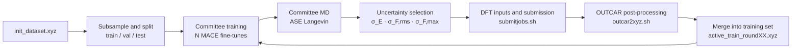

# mlip_auto_flow

**English** · [中文](README.zh-CN.md)

**A tiered evaluation framework and active-learning scripts for machine-learning interatomic potentials (MLIPs).**

**[Open MLIP Workbench](https://qundaoxu.github.io/mlip_auto_flow/workbench/)** · [Project overview](https://qundaoxu.github.io/mlip_auto_flow/)

The repository includes the evaluation and active-learning pipelines and their interactive web showcase:

| Part | Directory | What it does |
|---|---|---|
| Evaluation framework (core) | [`eval_framework/`](eval_framework/) | L0–L5 tiered diagnosis, from energy/force agreement up to the melt–quench pathway. Produces traceable metrics, grades, cross-model rankings, failing structures and data-acquisition suggestions |
| Active-learning scripts | [`al_flow/`](al_flow/) | MACE committee training → MD sampling → uncertainty-based selection → VASP labelling → OUTCAR post-processing and dataset merging, iterated |
| MLIP Workbench | [`docs/workbench/`](docs/workbench/) | Browser-based report cards, L0–L5 charts, model comparison, trajectory inspection and sampling with embedded GST225 results |

The command-line tools `mlipeval` and `alflow` ([`mlipeval_cli/`](mlipeval_cli/)) connect the two. The same two commands are the interface for integrating the project into a materials-computing platform.

---

## Contents

- [Web showcase](#web-showcase)
- [Background](#background)
- [Research questions](#research-questions)
- [The evaluation framework](#the-evaluation-framework)
- [The active-learning scripts](#the-active-learning-scripts)
- [Installation](#installation)
- [Configuration](#configuration)
- [End-to-end walkthrough](#end-to-end-walkthrough)
- [CLI reference](#cli-reference)
- [Platform integration](#platform-integration)
- [Repository layout](#repository-layout)

---

## Web showcase

[**MLIP Workbench — launch the application**](https://qundaoxu.github.io/mlip_auto_flow/workbench/)

Explore a model's report card, inspect its L0–L5 curves and metric records, overlay another model, adjust ranking weights, select a trajectory window, and collect diversity or uncertainty samples in the labelling basket. The application supports Chinese and English, light and dark themes, and desktop and mobile layouts; all typography uses Arial.

The showcase runs in the browser with embedded GST225 evaluation results. Calculations, model training and HPC jobs run through `mlipeval` and `alflow`; the web showcase does not submit jobs. See the [Workbench guide](docs/workbench/README.md) for the five workspaces and local launch instructions.


## Background

Machine-learning interatomic potentials now run large-scale molecular dynamics at close to DFT accuracy. What is still missing is a reproducible, quantitative answer to a simple question: is a given potential reliable for a given material? This project builds a tiered benchmark that answers it.

**How the models evolved.** MLIPs went from early BP/GAP models, through invariant models such as SchNet, to equivariant models such as NequIP and MACE, with accuracy improving at every step. Universal potentials trained on crystal databases (MPTrj, Alexandria and others), such as MACE-MPA-0, now handle most routine simulations zero-shot.

**Two bottlenecks.** Getting an accurate, reliable potential for a specific system is still hard:

- **Training data is hard to build.** Which structures go into a training set, and in what proportion, depends heavily on experience. There is no systematic way to find what is missing and add it.
- **Reliability is hard to assess.** A low energy and force RMSE does not mean the structure, diffusion or phase-change pathway is right. Physical validation metrics are scattered across papers, run under different protocols, and hard to compare.

**What a benchmark adds.** A tiered evaluation with uncertainties can grade a potential, guide efficient dataset construction, compare universal and specialised potentials along many dimensions, and give an automated potential-development agent a signal to optimise against. Putting the evaluation framework and the active-learning scripts in one repository is meant to close the loop: evaluate → find the failure → add data → retrain.

**Case systems.** The materials were chosen because they have mature published work and open-source potentials, and because their simulation needs cover a wide range of what a potential must do: Si, In₂O₃, Ge₂Sb₂Te₅ (GST225) and LiGePS. Phase one runs the full pipeline on the phase-change memory material GST225, which spans crystalline phases, liquid, amorphous solid and the melt–quench process, the most demanding combination of the four. Its reference data comprises 208 DFT/AIMD tasks under the protocol `gst225_pbe_canonical_v1`.

## Research questions

The core question: **with one set of reference data, one protocol and one set of frozen post-processing parameters, at which level of physical properties does an MLIP start to fail, by how much, whether that exceeds the reference's own statistical noise, and what training data should be added.**

Three concrete questions follow:

1. Used zero-shot on GST225, what is the error signature of a universal potential at each level?
2. Trained on system-specific data (same architecture as the universal potential, only the training data changes), which problems get fixed and which do not?
3. How do the size and composition of each generation of an active-learning dataset affect the scores at each level?

The answers are on the [project page](https://qundaoxu.github.io/mlip_auto_flow/): a ranking of universal and GST-specialised potentials, a level-by-level walkthrough of L0–L5, and a replay of eight AL generations.


**Fig. 1 | Relative scores of universal and specialised potentials on GST225.** **a** Overall score (best = 100); hatching marks a closed L1 gate. **b** Level scores. Each specialised potential shares its architecture with a universal one and differs only in training data. From MACE-MPA-0 to MACE-spec-GST the overall score rises from 76.8 to 80.3 and L0 from 63 to 90, while L1 drops from 93 to 50: the pair curves fail in the short-range region the training set does not cover.

---

## The evaluation framework

### L0–L5 tiered diagnosis

| Level | What it tests | Representative metrics | Reference |
|---|---|---|---|
| **L0** Reference agreement | Deviation of energies, forces and stresses from DFT, and where the errors occur | MAE / RMSE / P99 / max, binned by element, force magnitude and temperature stage | H5 audit set of 120 frames (canonical relabel) + crystalline diagnostic set |
| **L1** PES sanity | DFT-free pathology checks; the gate for the levels after it | Six pair PECs, translation/rotation invariance, F = −∇E, lattice scan, closest distance at 2000 K, timestep sensitivity, NVE drift | None |
| **L2** Static equilibrium | Ground state, relative energies, curvature of the PES | Relaxed volume, V₀/B₀ from fixed-volume ion-relaxed EOS, four-rung phase ladder order and ΔE, composition-corrected formation energy | Static DFT |
| **L3** Disordered structure | Short-range (L3a) and medium-range (L3b) order in liquid and amorphous GST | Partial RDF, ADF, coordination, homopolar bonds, Ge tetrahedral order, rings, ALTBC, S(q) | AIMD (three replicas per state point) |
| **L4** Dynamics | With the structure right, is atomic motion right too | Per-species MSD, self-diffusion Δlog₁₀D (with the fit window) | Constant-temperature AIMD |
| **L5** Process and phase change | The whole path through a temperature programme, not only its end | Evolution of RDF peak, CN, four-rings and tetrahedral Ge during melt–quench; first divergence; end-state error | AIMD melt–quench |

- **L1 is a gate.** If it finds NaNs, unphysical short bonds or broken energy conservation, the expensive L4/L5 are not run (`run_all.py` skips them).
- **Post-processing is frozen first.** L3 bond cutoffs come from the first minimum of the AIMD partial RDFs and are then frozen for both AIMD and MLIP-MD. Binning and the ring algorithm are frozen the same way, so only the MD engine differs between the two sides.
- Each level is worked through in [`eval_framework/notebooks/`](eval_framework/notebooks/) (nb01–nb06 for L0–L5, nb07 for the cross-model ranking; in Chinese). Metric definitions: [`eval_framework/METRICS.en.md`](eval_framework/METRICS.en.md) ([中文](eval_framework/METRICS.md)). Specification: [`docs/validation_methods_L0-L5.en.md`](docs/validation_methods_L0-L5.en.md) ([中文](docs/validation_methods_L0-L5.md)).

### Grading

A grade divides the distance between model and reference by the reference's own uncertainty. In one sentence: a model that is no further from AIMD than AIMD is from itself gets an A.

```text
σ_eff = max(σ_ref, d_protocol / 2)
z_eff = |distance(model, ref)| / σ_eff
z_eff ≤ 1 → A    1–2 → B    2–4 → C    > 4 → F
```

σ_ref comes from the spread between independent reference trajectories; d_protocol from the difference between two DFT protocols on the same structures. With a single reference trajectory no formal grade is given and the result is marked `provisional`. L3–L5 currently have three AIMD replicas and are graded formally; L0–L2 remain `provisional`.

Cross-model comparison uses a separate **relative score**: each indicator is mapped to `100 × (x_best + floor) / (x_i + floor)` and the levels are weighted L0 0.20, L1 0.15, L2 0.15, L3 0.25, L4 0.15, L5 0.10. The floor is the physical or statistical resolution of the indicator. Relative scores are not limited by `provisional`, because one reference biases every model the same way.

### Data roles and leakage control

- `training`: may be used for training.
- `diagnostic`: may be used to locate problems and choose new data.
- `protected_audit`: never used for new data, fine-tuning or hyperparameter selection.

Every specialised potential is screened for training-set leakage first: composition, then a total-RDF fingerprint, with a threshold of 0.02. Contaminated metrics are downgraded to `provisional`, and `mlipeval rank --clean` removes them for every model in a ranking (the AL ladder replay uses this mode). Labels from different DFT protocols (PBE, PBEsol, PBE+U, different pseudopotentials) are stored separately and never mixed into one RMSE.

### Code organisation

```text
eval_framework/scripts/
├── mlipeval/                  analysis package
│   ├── l0_reference.py        L0      ├── l3a_short_range.py   L3a
│   ├── l1_pes.py              L1      ├── l3b_medium_range.py  L3b
│   ├── l2_static.py           L2      ├── l4_dynamics.py       L4
│   ├── l5_pathway.py          L5      ├── uncertainty.py / ensemble.py   error scales, three-replica grading
│   ├── schema.py              MetricResult, grading     ├── ranking.py      relative scores, ranking
│   ├── leakage.py             leakage screens           ├── failure_export.py  candidate export
│   ├── models.py              model registry            ├── calculators.py  one interface over all backends
│   ├── config.py              site configuration        └── md_runner.py / md_lammps.py   MLIP-MD (ASE / LAMMPS)
├── run_l0.py … run_l5.py, run_mlip_md.py, run_all.py     one driver per level
├── run_ranking.py, run_report.py                          ranking and acceptance report (post-processing only)
├── submit_pbs.py, submit_al_ladder.py                     PBS job chains
└── screen_*_leakage.py, screen_al_ladder.py               training-set leakage screens
```

Every number is written as a `MetricResult` record (`metric_id`, `value`, `status`, `evidence_tier`, `grade`, `reference_protocol`, `structure_ids`, `failure_reason`, …) under `results/models/<model>/*.json`, so any number can answer: compared with what, under which protocol, and wrong on which structure.

Supported backends: mace-torch, nequip, deepmd-kit, mattersim and chgnet. Their dependencies conflict, so each model runs in its own conda environment.

---

## The active-learning scripts

`al_flow/` is an active-learning workflow built for phase-change memory materials. It closes the loop "committee model → uncertainty estimate → select high-uncertainty structures → DFT labelling → grow the training set → train the next round".



| Script | Role | What it does |
|---|---|---|
| [`activate_learning_full_flow.py`](al_flow/activate_learning_full_flow.py) | Main loop | Runs `--n_rounds` rounds end to end: subsample and split, write committee configs and train, MD, select frames, prepare DFT, submit, poll, merge, extend the training set |
| same file: `run_ase_md` + `select_uncertain_frames` | Sampling | Langevin MD with the committee (a frame every `md_write_interval` steps); σ_E, σ_F,rms and σ_F,max per frame; selection by threshold. `alflow sample` on the CLI |
| [`submitjobs.sh`](al_flow/submitjobs.sh) | DFT submission | Submits every `dft_cal/*/std.run` with `sbatch`, at most 30 in parallel (`ALFLOW_MAX_JOBS`), with progress from `squeue` |
| [`outcar2xyz.sh`](al_flow/outcar2xyz.sh) | DFT post-processing | Scans every OUTCAR, checks convergence (non-converged runs go to `non_converged_files.txt`) and writes energies, forces and stresses of the converged ones as multi-frame extxyz |
| same file: `python_merge_from_outcar` + `append_extxyz_concat` | Dataset packaging | Merges OUTCARs with ASE when the shell converter produced nothing, then appends the new labels to the training set as the next round's `active_train_roundXX.xyz` |
| [`run_al.sh`](al_flow/run_al.sh), [`config/config-01.yml`](al_flow/config/config-01.yml), [`dft_input/`](al_flow/dft_input/) | Examples | A sample run, a generated MACE committee config, VASP templates (INCAR and the Slurm job script; POTCAR is licensed and not included) |

**How frames are selected.** σ_E, σ_F,rms and σ_F,max are min–max normalised to [0, 1] within the trajectory; a frame is selected if any of the three exceeds `--uncert_threshold` (default 0.9), and the union is taken. Above `--uncert_max_frames`, the frames with the largest sum of the three are kept. The threshold is therefore relative: it picks frames within one trajectory and is not a convergence criterion.

**How it connects to the evaluation.** The inner loop, uncertainty sampling, only goes where the committee disagrees. The outer loop comes from the evaluation: failing structures from L0–L5 are deduplicated by `failure_export`, exported with a suggested DFT protocol (`mlipeval candidates`) and added to the next labelling round. The replay of eight AL generations ([project page](https://qundaoxu.github.io/mlip_auto_flow/#al)) shows the overall score rising from 55.7 to 85.1 but not monotonically with the number of frames, and every generation failing the pair-curve checks of L1. That is a gap uncertainty sampling alone does not reach and the evaluation does point to.

Runtime: Linux server or HPC with NVIDIA GPUs and Slurm; Python 3.12, PyTorch, MACE, ASE (full environment in [`al_flow/environment.yaml`](al_flow/environment.yaml)).

---

## Installation

```bash
git clone https://github.com/qundaoXu/mlip_auto_flow.git && cd mlip_auto_flow
pip install -e .            # the mlipeval / alflow commands (numpy, ase, pyyaml)
pip install -e ".[al]"      # active learning: mace-torch, scikit-learn, tqdm
```

The CLI uses the in-repo `eval_framework/` and `al_flow/` code by default. To use copies elsewhere, set `MLIPEVAL_HOME` (the directory containing `scripts/mlipeval/`) and `ALFLOW_HOME` (the directory containing `activate_learning_full_flow.py`).

## Configuration

No site path is hard-coded. Everything machine-specific lives in one file, `mlip_auto_flow.yaml` (YAML or JSON), shared by the evaluation and the active-learning side:

```bash
mlipeval config --init mlip_auto_flow.yaml   # write the template (same as config/mlip_auto_flow.example.yaml)
vi mlip_auto_flow.yaml                       # fill in your machine
mlipeval config --check                      # resolved values, and whether every path exists
alflow config                                # what the active-learning side will use
```

- **Lookup order:** `$MLIPEVAL_CONFIG` → `mlip_auto_flow.yaml` in the current directory → `mlip_auto_flow.yaml` at the repository root. With none of them, every default applies.
- **Precedence:** environment variable > config file > default. Any scalar can be overridden as `MLIPEVAL_<SECTION>_<KEY>`, for example `MLIPEVAL_SCHEDULER_WALLTIME`.
- **Paths:** relative paths resolve against `paths.workspace`; `${VAR}` and `~` are expanded.

The defaults reproduce the original workspace layout, with reference data and models one level above `eval_framework/`. On the original cluster only three keys are needed: `paths.workspace`, `environment.conda_root` and `scheduler.project`.

### What needs to be configured

**Evaluation (`mlipeval`)**

| Key | Purpose | Default | Environment variable |
|---|---|---|---|
| `paths.workspace` | Root of the reference data and model runs | parent of `eval_framework/` | `MLIPEVAL_WORKSPACE` |
| `paths.output` | Where `results/` and `data/` (cache, reference labels, per-model outputs) are written | `eval_framework/` | `MLIPEVAL_OUTPUT` |
| `paths.reference.gst_ref` | Legacy AIMD, cubic seed structures, MP structures | `GST225_ref` | |
| `paths.reference.phase1` | The 208 phase-1 VASP tasks and `task_manifest.csv` | `phase1_vasp_inputs_20260828` | |
| `paths.models.universal` | Universal potentials, one subdirectory per model (checkpoint + `pair.in`) | `MLIP_run/universal_MLIP` | |
| `paths.models.specialised` | Specialised potentials | `MLIP_run/specialized` | |
| `paths.models.al_ladder` | AL-ladder models (`model/`, `pair/`) | `MLIP_run/specialized/al_ladder` | |
| `paths.models.gst_aging` | MACE-GST225-Aging model directory | `../myproject/1-GST225-aging` | |
| `paths.training_sets.*` | Training sets of the specialised potentials, read only by the leakage screens (GST-ACE-24, processed_NE, aging, AL generations) | see template | |
| `environment.conda_root` | conda installation; job scripts source its `etc/profile.d/conda.sh` | derived from `$CONDA_EXE` | `MLIPEVAL_CONDA_ROOT` |
| `environment.conda_envs` | conda environments directory | `<conda_root>/envs` | `MLIPEVAL_CONDA_ENVS` |
| `environment.backend_envs` | Backend → environment (mace, nequip, deepmd, mattersim, chgnet) | mace / nequip / deepmd / gnnp / gnnp | |
| `lammps.executable` | LAMMPS binary for L3–L5 MD | `MLIP_run/universal_MLIP/_build/advancesoft_build/lmp` | `MLIPEVAL_LMP` |
| `lammps.common_dir` | Shared mliap scripts | `MLIP_run/universal_MLIP/common` | |
| `lammps.al_ladder_export` | Script that exports AL-ladder models to mliap | `MLIP_run/specialized/al_ladder/export_mliap.sh` | |
| `scheduler.project` | PBS `-P` project code; the line is omitted when unset | none | `MLIPEVAL_PBS_PROJECT` |
| `scheduler.queue` | PBS queue; PBS routes the job when unset | none | `MLIPEVAL_PBS_QUEUE` |
| `scheduler.select` / `walltime` | Resource request and default walltime | 1 GPU, 12 CPU, 225 GB; 12 h | |
| `scheduler.modules` | Modules loaded in every job | gcc/13.1.0, openmpi/gcc/64/4.1.8 | |
| `scheduler.require_compute_node` | Whether heavy drivers must run inside a PBS job (set false on a workstation) | true | |
| `models.<key>` | Extra or overriding model entries, without editing `models.py` | none | |

Each `models.<key>` entry needs `label`, `backend` and `checkpoint`, and may set `conda_env`, `dtype`, `native_protocol`, `lammps_route`, `lammps_pair_in`, `load_path` and `group`. L3–L5 need `lammps_route` and `lammps_pair_in`.

**Runtime variables (not in the file):** `MLIPEVAL_MODEL` (current model), `MLIPEVAL_MD_ENGINE` (`lammps` or `ase`) and `MLIPEVAL_THREADS`. `mlipeval run` and the PBS job scripts set all three.

**Active learning (`alflow`, the `alflow:` section)**

| Key | Purpose | Passed as |
|---|---|---|
| `alflow.run.*` | Every option of `activate_learning_full_flow.py`: data path, foundation model, subsampling and split ratios, committee size, seeds and epochs, MD temperature and steps, selection threshold, rounds, DFT directories and polling | command-line arguments |
| `alflow.run.foundation_model` | MACE foundation model to fine-tune | or `$ALFLOW_FOUNDATION_MODEL` |
| `alflow.dft.partition` / `account` | Slurm partition and account | `SBATCH_PARTITION` / `SBATCH_ACCOUNT` |
| `alflow.dft.modules` | Modules to load before VASP | `VASP_MODULES` |
| `alflow.dft.vasp_cmd` | VASP command line | `VASP_CMD` (default `mpirun -np $SLURM_NTASKS vasp_std`) |
| `alflow.dft.max_jobs` | Limit on DFT jobs submitted at once | `ALFLOW_MAX_JOBS` (default 30) |

The VASP template (`al_flow/dft_input/std.run`) contains no site information and reads only these variables. Put your own POTCAR in `dft_input/`.

## End-to-end walkthrough

One complete example ties the workflow together: evaluate the universal potential MACE-MPA-0 on GST225, find its weak levels, run one round of active learning to add data and fine-tune a new model, then evaluate the new model against the original. The outputs in step 1 are real; the counts in steps 2 and 3 are illustrative.

### Step 0: install and configure

```bash
git clone https://github.com/qundaoXu/mlip_auto_flow.git && cd mlip_auto_flow
pip install -e ".[al]"
mlipeval config --init mlip_auto_flow.yaml
```

Fill in at least these keys in `mlip_auto_flow.yaml` and keep the rest at their defaults:

```yaml
paths:
  workspace: /data/MLIP_benchmark          # holds GST225_ref/, phase1_vasp_inputs_20260828/ and MLIP_run/
environment:
  conda_root: /opt/miniconda3
scheduler:
  project: MY-PBS-PROJECT                  # workstation without PBS: drop this, set require_compute_node: false
alflow:
  run:
    foundation_model: /data/models/mace-mpa-0-medium.model
  dft:
    partition: cpu64
    vasp_cmd: "mpirun -np 64 vasp_std"
```

```bash
mlipeval config --check        # lists every path; missing ones are marked
```

### Step 1: evaluate an existing model

```bash
mlipeval models                                  # ✓ marks models that already have results
mlipeval submit --model mace_mpa0 --chain        # L0 → L1 → L2 → MD → L3 → L4 → L5 as a PBS dependency chain
#   on a workstation: mlipeval run all --model mace_mpa0
```

When the jobs finish, read the report card (post-processing only, fine on a login node):

```console
$ mlipeval card --model mace_mpa0
MACE-MPA-0 (medium)  —  overall 76.8  (rank 7/9, all scoring)
  L0   63.4
  L1   93.4
  L2   67.5
  L3   76.5
  L4   75.9
  L5   94.5
  L1 gate: pass
  candidates for the next labelling round: 2
```

How to read it: the potential energy surface is sound (the L1 gate is open), but L0 (energies and forces) and L2 (crystal phases, bulk modulus) are the weak levels. The framework has already exported the structures to label next:

```console
$ mlipeval candidates --model mace_mpa0 --out round1/eval_candidates
L0_diagnostic_manifest.json: 2 candidates (from 10, greedy farthest-point on MACE invariant descriptors, min distance 0.02)
  L0_worst_00    L0.force_max     max per-atom force-vector error in the frame = 0.425 eV/A
  L0_worst_03    L0.force_max     max per-atom force-vector error in the frame = 0.361 eV/A
copied .../results/models/mace_mpa0/candidates -> round1/eval_candidates
```

### Step 2: one round of active learning

Prepare an AL working directory with `data/init_dataset.xyz` (initial extxyz data with `REF_energy` / `REF_forces` / `REF_stress`), `data/small_cell_traj.xyz` (MD starting structure) and `dft_input/` (INCAR and std.run copied from `al_flow/dft_input/`, plus your own POTCAR).

**Option A: the whole loop in one command.** Rounds, MD conditions and the selection threshold come from `alflow.run`:

```bash
alflow run --config mlip_auto_flow.yaml
```

**Option B: stage by stage.** This suits a platform scheduler and lets you add the evaluation's candidates to the labelling queue:

```bash
# 2a. fine-tune four MACE models as a committee
alflow train --train data/sub_train.xyz --valid data/sub_val.xyz --test data/sub_test.xyz --n-comm 4 --epochs 100

# 2b. committee MD + uncertainty selection
alflow sample --models committee/model{1,2,3,4}/comm_v1_model*.model \
              --init-conf data/small_cell_traj.xyz --temp 600 --steps 5000 --max-frames 100
#   -> {"selected": 100, "frames": "comm_traj/uncertain_frames.xyz", ...}

# 2c. combine uncertain frames with the evaluation candidates, write VASP tasks, submit and wait
cat comm_traj/uncertain_frames.xyz round1/eval_candidates/L0_diagnostic.xyz > round1/to_label.xyz
alflow label --frames round1/to_label.xyz --template-dir dft_input --submit --wait
#   -> {"prepared": 102, "submitted": true, "done": 101, "failed": [...]}

# 2d. OUTCAR -> extxyz (non-converged tasks are listed in dft_cal/non_converged_files.txt)
alflow collect --root dft_cal

# 2e. merge into the training set and fine-tune again on the new data
alflow merge --base data/sub_train.xyz --new dft_cal/dft_merged.extxyz --out data/train_round1.xyz
alflow train --train data/train_round1.xyz --valid data/sub_val.xyz --test data/sub_test.xyz \
             --n-comm 4 --epochs 100 --committee-dir committee_r1 --config-dir config_r1
```

`alflow label` clears the numbered task directories under `dft_cal/` on every call, so combine everything to be labelled into one file and call it once.

### Step 3: evaluate the new model

Register the new model in `mlip_auto_flow.yaml`; no code changes are needed:

```yaml
models:
  mace_gst_r1:
    label: "MACE-MPA-0 + AL round 1"
    backend: mace
    checkpoint: /data/al_run/committee_r1/model1/comm_v1_model1.model
    dtype: float64
    native_protocol: "PBE (gst225_pbe_canonical_v1)"
    lammps_route: mliap                     # for L3–L5: export the model to LAMMPS mliap first,
    lammps_pair_in: /data/al_run/committee_r1/model1/pair.in   # then write its pair_style / pair_coeff
    group: specialised
```

```bash
mlipeval submit --model mace_gst_r1 --chain
mlipeval card --model mace_gst_r1 --against mace_mpa0,mace_gst_r1
mlipeval rank --models mace_mpa0,mace_gst_r1 --markdown --out-stem r1_vs_mpa0
#   -> results/ranking_r1_vs_mpa0.json, results/RANKING_REPORT_r1_vs_mpa0.md
```

The report card decides the next step. If the gate is open and the scores meet the target, release the model. If the gate is closed or a level lags, export the new failing structures with `mlipeval candidates --model mace_gst_r1` and go back to step 2.

### Where the results are

| What | Where |
|---|---|
| Every metric (MetricResult) | `<paths.output>/results/models/<model>/L*.json` |
| Candidates for labelling | `<paths.output>/results/models/<model>/candidates/*.xyz` + `*_manifest.json` |
| Rankings | `<paths.output>/results/ranking_<stem>.json`, `RANKING_REPORT_<stem>.md` |
| PBS logs | `<paths.output>/results/pbs/*.log` |
| Per-round AL outputs | `committee*/`, `comm_traj/`, `dft_cal/`, `data/train_round*.xyz` |

## CLI reference

### `mlipeval`: evaluation

```text
mlipeval config     [--check [--strict]] [--json] [--init PATH]   show / check / create the site config
mlipeval models     [--json]                              registered models and whether they have results
mlipeval run LEVEL  --model KEY [driver options...]       LEVEL ∈ l0 l1 l2 md l3 l3u l4 l5 all
mlipeval submit     [--model KEY | --al-ladder] [...]     write and submit a PBS dependency chain
mlipeval rank       [--models a,b,..] [--clean] [--markdown] [--out-stem S] [--level-weights L3=0.35,..]
mlipeval card       --model KEY [--against a,b,..] [--clean] [--json]   report card for one model (read-only)
mlipeval candidates --model KEY [--out DIR]               show / export candidate structures
mlipeval leakage    {h5,diagnostic,al-ladder}             training-set leakage screens
mlipeval report     --model KEY [--markdown]              phase-1 acceptance report
```

`run` sets `MLIPEVAL_MODEL=KEY` and calls the matching `run_*.py`; unknown options are passed through unchanged:

```bash
mlipeval run l0 --model nequip_oam_l --set audit --refresh
mlipeval run l3 --model mace_mpa0 --state canon_amorphous_300K
mlipeval run all --model mace_spec_gst                 # the whole chain; L4/L5 are skipped when the L1 gate is closed
mlipeval submit --model mace_spec_gst --chain          # one PBS job per level, chained by dependency
mlipeval rank --models mace_mpa0,nequip_oam_l,dpa4_pro,mattersim_5m,chgnet_030,mace_spec_gst,mace_spec_gst_ne,nequip_spec_gst,mace_gst_aging \
              --markdown --out-stem showcase9      # the ranking in Fig. 1
mlipeval card --model mace_mpa0 --json                 # machine-readable report card
```

MACE and MD work must run on compute nodes, and the heavy drivers check this themselves. `models`, `rank`, `card`, `candidates` and `leakage` are post-processing only and run on a login node.

### `alflow`: active learning

```text
alflow [--config mlip_auto_flow.yaml] SUBCOMMAND ...     --config may also follow the subcommand
alflow config                                             run options and DFT environment that will be used
alflow run      [script options...]                       the whole loop (forwarded to activate_learning_full_flow.py)
alflow train    --train --valid --test [--foundation-model M] [--n-comm 4] [--epochs 100] [--configs-only]
alflow sample   --models m1 m2 .. (--init-conf X | --traj T) [--temp 300] [--steps 1000] [--threshold 0.9] [--max-frames 200] [--device cuda]
alflow label    --frames F --template-dir D [--root dft_cal] [--submit] [--wait]
alflow collect  [--root dft_cal] [--out merged.extxyz] [--python-only]
alflow merge    --base train.xyz --new merged.extxyz --out next.xyz
```

```bash
alflow run --config mlip_auto_flow.yaml               # reads the alflow.run and alflow.dft sections
alflow run --config examples/alflow.yaml               # a flat YAML of run options also works
```

Each stage prints one line of JSON so a scheduler can track state. `label` first deletes the numbered subdirectories and `*.xyz` files under `--root`.

## Platform integration

A platform calls the project as two command-line tools and needs no internal imports.

| Contract | Details |
|---|---|
| Input | Models are registered under `models.<key>` in the config file (backend, checkpoint, conda environment, LAMMPS route, dtype, training protocol); built-in models live in `models.py`. AL input is extxyz (`REF_energy` / `REF_forces` / `REF_stress`) plus a VASP template directory |
| Output | `results/models/<key>/*.json` (MetricResult), `results/models/<key>/candidates/*.xyz` + `*_manifest.json`, `results/ranking_<stem>.json`. The stdout of `card --json`, `models --json` and every `alflow` stage is JSON |
| Exit codes | The driver's exit code is passed through. A closed L1 gate is not a failure; read `l1_gate` in the report card |
| Order | `l0 → l1 → l2 → md → l3 → l3u → l4 → l5` |

An evaluation-driven training job can be orchestrated as:

```text
1. alflow train / sample / label / collect / merge        inner loop, every round
2. register the model -> mlipeval run l0 / l1 / l2         quick evaluation
3. mlipeval card --model NEW --json                       gate and scores -> continue or release
4. mlipeval candidates --model NEW --out next_round/       outer loop: failing structures join the next label
5. milestones: mlipeval run md / l3 / l4 / l5 --model NEW  full evaluation
```

## Repository layout

```text
mlip_auto_flow/
├── eval_framework/          evaluation framework (scripts/, notebooks/, METRICS.md / METRICS.en.md)
├── al_flow/                 active-learning scripts
├── mlipeval_cli/            the mlipeval / alflow commands
├── config/mlip_auto_flow.example.yaml   site-config template (evaluation + active learning)
├── examples/alflow.yaml     a flat config with AL run options only
├── docs/                    project page (GitHub Pages)
│   ├── index.html
│   ├── workbench/           MLIP Workbench web showcase (standalone HTML + guide)
│   ├── figures/             Fig. 1–8 (PNG + PDF)
│   ├── notebooks/           one notebook per figure + style.py (Nature layout, 183 mm wide)
│   └── validation_methods_L0-L5.md / .en.md
├── README.md / README.zh-CN.md
└── pyproject.toml
```

The figures are generated from the evaluation results by `docs/notebooks/fig*.ipynb`. Tell them where the results are first:

```bash
export MLIPEVAL_OUTPUT=/path/to/eval_framework   # working copy with results/ and data/ (or set paths.output)
cd docs/notebooks && for nb in fig*.ipynb; do jupyter nbconvert --to notebook --execute --inplace "$nb"; done
```
