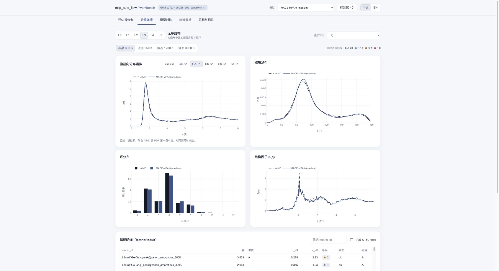
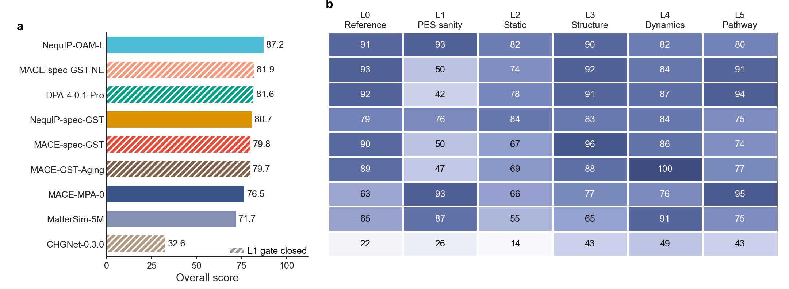
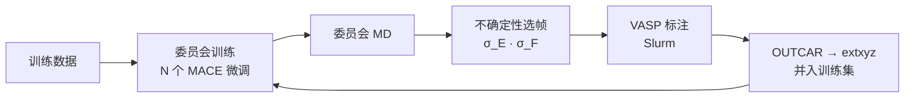

# mlip_auto_flow

[English](README.md) · **中文**

**在模拟出问题之前，先知道势函数会在哪里出问题。**

mlip_auto_flow 是一套带物理约束的机器学习势函数（MLIP）六级评估框架，配有主动学习采样脚本。它用同一份冻结的 DFT/AIMD 参考，从能量、力误差一直检查到熔融–淬火路径，把每个势函数的问题定位到具体层级、具体数值和具体构型，并给出下一轮应该补算哪些结构。

**[在线体验 MLIP Workbench](https://qundaoxu.github.io/mlip_auto_flow/workbench/)** · [项目主页](https://qundaoxu.github.io/mlip_auto_flow/) · [参考手册](docs/reference.zh-CN.md)



---

## 1. 为什么需要这个评估框架

机器学习势已经能以接近 DFT 的精度跑分子动力学。MACE-MPA-0 这类通用势零样本就能处理大多数材料，针对单一体系的专用势也越来越多。但有一个问题至今没有标准答案：**这个势函数，对这个材料，到底可不可信？**

- **力误差小不等于可靠。** 一个势函数可以力误差很低，却把液态结构、扩散或晶化路径算错。
- **验证方法分散。** 各项物理检查散落在不同论文里，协议各不相同，结果无法横向比较。
- **训练数据靠经验。** 训练集缺什么结构、为什么缺，没有系统的方法回答。

mlip_auto_flow 把这些问题放进同一套协议：所有势函数用同一份参考数据、同一套冻结的后处理来检验，每一处失效都追溯到层级、数值和对应的构型，并直接进入下一轮标注。形成闭环：**评估 → 定位失效 → 补数据 → 再训练。**

## 2. 评估框架

### 六个层级，从数值到物理

| 层级 | 回答的问题 | 检查内容 |
|---|---|---|
| **L0** 数值一致性 | 给定构型上，能量、力、应力算得准不准 | 与 DFT 的误差，按元素、力大小、状态分开统计 |
| **L1** 势能面健全性 | 势能面有没有病理 | 二体曲线、不变性、能量与力的一致性、NVE 漂移、高温稳定性 |
| **L2** 静态平衡性质 | 晶相对不对 | 弛豫体积、状态方程（V₀、B₀）、相序、形成能 |
| **L3** 无序结构 | 液态和非晶对不对 | RDF、键角、配位数、环统计、S(q) |
| **L4** 动力学 | 原子运动对不对 | 分元素扩散系数 |
| **L5** 过程与相变 | 熔融–淬火路径对不对 | 结构量随温度的演化、首次偏离 AIMD 的温度 |

### 你能得到什么

- **门控，节省算力。** L1 是通过/不通过的检查。势能面有问题的模型，在跑昂贵的 L4/L5 之前就被拦下。
- **以参考自身的涨落为尺度判级。** 模型与 AIMD 的差距不超过几条独立 AIMD 之间的差距，就判 A。每个数都记录了参考来源、计算协议和对应构型。
- **相对分与排名。** 通用势和专用势放在同一把尺子上，逐层比较，权重可调。
- **下一轮要补算的构型。** 最差的构型去重后导出，并附上建议的 DFT 协议。
- **训练集泄漏控制。** 专用势训练时见过的指标会被标记，排名时可以统一排除。
- **打分离开集群。** 集群只负责调用模型，产出评估数据包；L0–L2 在任何一台 CPU 上用同一套代码打分。
- **MLIP Workbench。** 交互式网页软件：评估报告卡、L0–L5 曲线、模型对比、轨迹分析、采样，以及在浏览器里直接分析 L0–L2 的上传面板。

支持五类模型：MACE、NequIP、DeePMD、MatterSim、CHGNet。



**Fig. 1｜九个势函数在 GST225 上的结果。** 从 MACE-MPA-0 到 MACE-spec-GST，只换了训练数据：L0 从 63 升到 90，L1 却从 93 降到 50，因为专用势的二体曲线在训练数据覆盖不到的短程区失效。分层评估看得到的问题，单个误差数字看不到。

## 3. 采样脚本

`al_flow/` 负责补数据：几个微调过的 MACE 模型组成委员会跑 MD，委员会意见不一致的结构送去做 DFT。



- **一条命令跑完整个循环**（`alflow run`），也可以分阶段运行（`train`、`sample`、`label`、`collect`、`merge`），方便平台调度。
- **不确定性采样**：按委员会在能量和力上的分歧选帧。
- **DFT 流程内置**：生成 VASP 输入、提交并轮询作业、检查收敛，再把结果并入下一轮训练集。
- **与评估打通**：不确定性采样只能找到委员会有分歧的地方；评估补上它看不到的部分：L0–L5 的失效构型（`mlipeval candidates`）和不确定帧一起进入同一批标注。

在 GST225 的 8 代主动学习回放中，总分从 59.9 升到 81.8，但并不随数据量单调上升；而且没有一代通过 L1 门控。这个缺口靠不确定性采样发现不了，评估直接指了出来。

## 4. 评估流程示例：GST225

第一个完整案例是相变存储材料 GST225（Ge₂Sb₂Te₅）。它同时涉及晶相、液态、非晶和熔融–淬火过程。参考数据是同一协议 `gst225_pbe_canonical_v1` 下的 208 个 DFT/AIMD 任务。目前已评估 17 个势函数：5 个通用势、4 个 GST 专用势、8 代主动学习模型。

### 在浏览器里体验（一分钟）

1. 打开 [MLIP Workbench → 新建评估](https://qundaoxu.github.io/mlip_auto_flow/workbench/#new)。
2. 从 9 个展示模型中选一个，点击 **一键填入**：GST225 的 DFT 参考和该模型的产出按层级载入。
3. 点击 **分析全部已就绪层级**：L0–L2 在浏览器里计算完成，结果与 HPC 上的逐项一致。
4. 点击 **生成报告卡**：查看该模型的分数，以及它在另外 8 个模型中的排名。

同一个面板也可以上传你自己的 DFT 和 MLIP 数据，每一层需要的文件格式都写在面板里。

### 在集群上运行

**安装与配置**

```bash
git clone https://github.com/qundaoXu/mlip_auto_flow.git && cd mlip_auto_flow
pip install -e ".[al]"
mlipeval config --init mlip_auto_flow.yaml     # 填写 paths.workspace、environment.conda_root、scheduler.project
mlipeval config --check
```

**评估一个模型**

```bash
mlipeval submit --model mace_mpa0 --chain      # L0 → L1 → L2 → MD → L3 → L4 → L5，提交为一条 PBS 依赖链
mlipeval card --model mace_mpa0
```

```console
MACE-MPA-0 (medium)  —  overall 76.5  (rank 7/9, all scoring)
  L0   63.4
  L1   93.4
  L2   65.9
  L3   76.5
  L4   75.9
  L5   94.5
  L1 gate: pass
  candidates for the next labelling round: 2
```

结论很清楚：势能面健全，但能量与力（L0）和晶相（L2）是短板。框架已经挑好了补这两块要用的构型：

```bash
mlipeval candidates --model mace_mpa0 --out round1/eval_candidates
```

**补数据、再训练**

```bash
alflow train  --train data/sub_train.xyz --valid data/sub_val.xyz --test data/sub_test.xyz --n-comm 4
alflow sample --models committee/model*/comm_v1_model*.model --init-conf data/small_cell_traj.xyz --temp 600
cat comm_traj/uncertain_frames.xyz round1/eval_candidates/*.xyz > round1/to_label.xyz
alflow label  --frames round1/to_label.xyz --template-dir dft_input --submit --wait
alflow collect --root dft_cal
alflow merge  --base data/sub_train.xyz --new dft_cal/dft_merged.extxyz --out data/train_round1.xyz
```

**评估新模型并与旧模型比较**

在 `mlip_auto_flow.yaml` 的 `models:` 下登记新的 checkpoint，不需要改代码。然后运行：

```bash
mlipeval submit --model mace_gst_r1 --chain
mlipeval rank --models mace_mpa0,mace_gst_r1 --markdown --out-stem r1_vs_mpa0
```

门控通过、分数达标，就发布模型；否则导出新的失效构型，再跑一轮。

## 5. 接口与集成

mlip_auto_flow 有四种方式接入材料计算平台，按数据在哪里来选：

| 接口 | 适用场景 | 用法 |
|---|---|---|
| **命令行** | 平台在 HPC 上调度作业 | `mlipeval`（评估）和 `alflow`（主动学习）。`card --json`、`models --json` 和 `alflow` 的每个阶段都输出 JSON，退出码原样返回 |
| **评估数据包** | 模型在集群上跑，打分在别处 | `mlipeval pack model --model KEY` 生成 `.mlippack`；`mlipeval rescore PACK` 在任意 CPU 上为 L0–L2 打分，并对照冻结的参考校验数据包 |
| **Web API** | 需要以服务方式提供 | `mlipeval serve` 启动本地后端：上传数据包、校验、重算，结果以 JSON 返回，也可以在 Workbench 页面里查看 |
| **浏览器上传** | 不安装任何东西，先试自己的数据 | Workbench「新建评估」面板按层级读取 extxyz/CSV/JSON，在本机计算 L0–L2，数据不上传 |

**接入新模型**只需要在配置文件里加一项，写明后端、checkpoint、conda 环境和 LAMMPS 接口。GST225 的 17 个模型已经内置。

**输出**都是普通文件：每项指标一条 JSON 记录（`results/models/<model>/*.json`），补算构型是 extxyz 加清单文件，排名是 JSON 和 Markdown。

一个由评估驱动的训练任务通常这样编排：

```text
alflow train → sample → label → collect → merge              内循环，每一轮
mlipeval run l0 / l1 / l2  →  mlipeval card --json            快速评估：继续还是发布
mlipeval candidates --out next_round/                         失效构型进入下一轮标注
mlipeval run md / l3 / l4 / l5                                里程碑节点做完整评估
```

## 更多文档

- [MLIP Workbench 使用说明](docs/workbench/README.md)：六个工作区、上传格式、本地运行
- [参考手册](docs/reference.zh-CN.md)：配置项、完整命令行参考、结果文件、仓库结构
- [评估数据包与 Web API](eval_framework/PACKS.md)
- [指标定义](eval_framework/METRICS.md)与 [L0–L5 规范](docs/validation_methods_L0-L5.md)
- 逐层分析的 notebook：[`eval_framework/notebooks/`](eval_framework/notebooks/)
